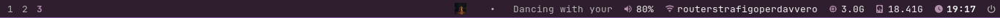

# dellarchdotfiles

My Arch Linux + Hyprland desktop on a Dell laptop (1366×768), built around a
dark purple palette shared by Kitty, Rofi and Waybar.



## Stack

- **Hyprland 0.56** — Lua configuration (`hyprland.lua`)
- **Waybar 0.15** — custom modules, cover-art music widget, power menu button
- **Rofi 2.0** — `purple` theme with Nerd Font icons
- **Kitty** — terminal
- **PipeWire / WirePlumber** — audio, controlled with `wpctl` / `pactl`
- **iwd + systemd-networkd + systemd-resolved** — Wi-Fi and networking
  (no NetworkManager)
- **hyprpaper**, **dunst**, **qimgv**, **Dolphin**, **Firefox**

## Repo layout

```
.config/hypr/            Hyprland Lua config, keybinds, autostart, hyprpaper
.config/waybar/          bar modules, palette CSS, music widget scripts
.config/rofi/            launcher config (uses the system purple.rasi theme)
.config/kitty/           terminal
.config/qimgv/           image viewer preferences
.config/mimeapps.list    default apps (qimgv for images)
.config/{gtk-3.0,gtk-4.0,qt5ct,qt6ct,environment.d}  dark theme plumbing
.local/bin/              volume-menu, network-menu, power-menu, screenshot,
                         color-picker, clipboard-*, wallpaper
system/                  networkd + iwd files to install in /etc
docs/waybar.png          bar screenshot
```

## Custom bits

- **Music widget** — shows cover art and track title; the title scrolls only
  when it does not fit. Clicking opens a popup with transport controls and a
  seek bar, and the cover updates when the track changes.
- **Volume menu** — click the speaker icon for output devices, set default,
  move streams, open the mixer or mute.
- **Network menu** — click the network icon for connection status, Wi-Fi
  scan/connect (passwords masked), DNS presets, DHCP renew and details.
  Built natively on `iwd`, `networkctl` and `resolvectl`.
- **Power menu** — sleep, restart, shutdown, logout.
- **Screenshot tool** — full screen / region / window, then save or copy.
- **Clipboard history**, colour picker and wallpaper switcher in `~/.local/bin`.

## Palette

| Token      | Hex       |
|------------|-----------|
| background | `#2f1e2e` |
| surface    | `#3b2839` |
| surface1   | `#4a3347` |
| accent     | `#815ba4` |
| accent alt | `#b48ead` |
| urgent     | `#ef6155` |
| foreground | `#eff0f1` |
| muted      | `#7f8c8d` |

## Keybinds

`Super` is the main modifier.

| Keys | Action |
|------|--------|
| `Super` (tap) | Rofi drun launcher |
| `Super+T` | Kitty |
| `Super+W` | Firefox |
| `Super+E` | Dolphin |
| `Super+C` | Vim in Kitty |
| `Super+Q` | Close window |
| `Super+F` / `Super+Alt+F` | Fullscreen / maximize |
| `Super+Alt+Space` | Toggle floating |
| `Super+P` | Pin window |
| `Super+J` | Toggle split (dwindle) |
| `Super+1…0` | Focus workspace |
| `Ctrl+Super+1…0` | Focus workspace group 11…20 |
| `Super+Alt+1…0` | Move window to workspace |
| `Ctrl+Super+Alt+1…0` | Move window to workspace group |
| `Super+Shift+1…0` | Move window silently |
| `Super+↑/↓/←/→` | Focus direction |
| `Super+Shift+↑/↓/←/→` | Move window in direction |
| `Super+mouse_up/down`, `Ctrl+Super+←/→`, `Super+Page_Up/Down` | Previous/next workspace |
| `Ctrl+Super+mouse_up/down` | Previous/next workspace group |
| `Super+Alt+Page_Up/Down` | Move window to previous/next workspace |
| `Super+S` / `Super+Alt+S` | Scratchpad / move window to scratchpad |
| `Alt+Tab` / `Shift+Alt+Tab` | Cycle windows |
| `Ctrl+Alt+Tab` / `Ctrl+Shift+Alt+Tab` | Cycle window groups |
| `Super+Comma` / `Super+Shift+Comma` | Toggle / lock group |
| `Super+U` | Move window out of group |
| `Super+Z` / `Super+X` | Drag / resize window with mouse |
| `Super+-` / `Super+=` | Resize width |
| `Super+Shift+-` / `Super+Shift+=` | Resize height |
| `Super+Alt+arrows` | Resize |
| `Ctrl+Super+Backslash` | Center window |
| `Ctrl+Shift+Escape` | btop on the sysmon scratchpad |
| `Super+M` | Music popup |
| `Super+Shift+M` | Mute output |
| `Ctrl+Super+Space` | Play/pause |
| `Ctrl+Super+=` / `Ctrl+Super+-` | Next / previous track |
| `Print` | Screenshot menu |
| `Super+Shift+S` | Region screenshot |
| `Super+Shift+C` | Colour picker |
| `Ctrl+Alt+Delete` | Power menu |
| `Super+Shift+L` | Suspend |
| `Super+V` / `Super+Alt+V` | Clipboard history / delete entry |
| `Ctrl+Alt+V` | pavucontrol |
| `Ctrl+Alt+C` | Close notifications |
| `XF86Audio*` | Volume, mute, mic mute, play/next/previous |
| `XF86MonBrightnessUp/Down` | Brightness |

### Bar clicks

- **Volume** — left: output devices; right: mute; middle: pavucontrol.
- **Network** — left: connection menu; right: DNS settings; middle: details.
- **Power** — sleep / restart / shutdown / logout.

## Install

The repository mirrors `$HOME`. `install.sh` backs up existing files first.

```bash
git clone https://github.com/kevodevp/dellarchdotfiles.git
cd dellarchdotfiles
./install.sh
```

Waybar and the polkit agent run as systemd user services:

```bash
systemctl --user enable --now waybar.service hyprpolkitagent.service
```

Hyprpaper and the clipboard watcher are started by Hyprland's
`hyprland.start` hook, so they come up with the session automatically.

Core packages:

```bash
sudo pacman -S --needed \
  hyprland hyprpaper waybar rofi kitty dunst \
  pipewire pipewire-pulse wireplumber pavucontrol playerctl \
  iwd grim slurp wl-clipboard brightnessctl \
  ttf-jetbrains-mono-nerd noto-fonts \
  dolphin firefox btop htop python \
  hyprpolkitagent xdg-desktop-portal-hyprland
```

`qimgv` is not in the official repositories on this machine; install the AUR
package:

```bash
yay -S qimgv-git
```

Install the system network files (needs root) as described in
[`system/README.md`](system/README.md).

## Notes

- `hyprland.lua` is the configuration Hyprland actually loads. An old
  `hyprland.conf` from the initial install is ignored and is not tracked here.
- Waybar and `hyprpolkitagent` are enabled as systemd user services; hyprpaper
  and the clipboard watcher start from the `hyprland.start` event.
- Rofi has a `no_anim` layer rule and `screenshot` waits for its layer to
  disappear before capturing, so menus never show up in screenshots.
- Waybar's `on-click` commands use absolute `/home/brunomars/.local/bin/...`
  paths; adjust them if your username is different.
- `hyprpaper.conf` points at `/home/brunomars/Downloads/524440.jpg`; change the
  path or run `wallpaper <file>`.
- `hyprpaper.conf` sets `splash = 0` because hyprpaper 0.8.4 paints Hyprland's
  splash text at the bottom of the screen.
- The DNS menu writes drop-ins to
  `/etc/systemd/network/<file>.d/99-waybar-dns.conf` and reloads networkd
  through polkit.
